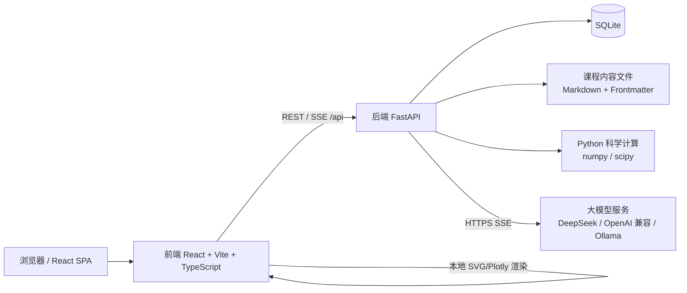
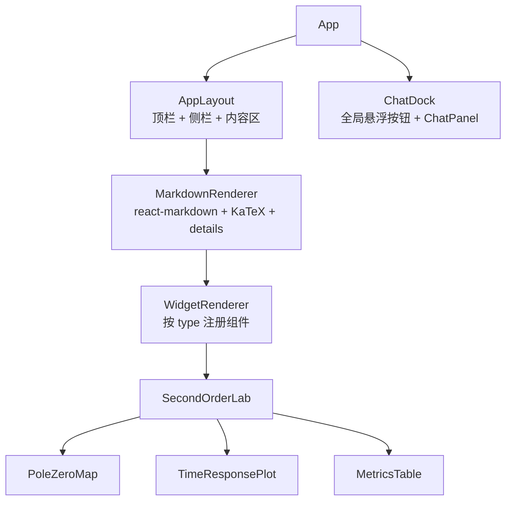

# StudyPlusPlus · 技术方案与架构

> 版本：v0.1  
> 读者：后端、前端、算法、测试智能体

---

## 1. 总体架构



- 前后端分离开发，生产构建时由 FastAPI 托管前端静态文件，最终用户只访问一个端口。
- 所有科学计算、指标计算、内容解析、LLM 调用都在后端。
- 前端只负责展示、交互状态管理和请求编排。

---

## 2. 技术选型

| 层 | 选型 | 理由 |
| --- | --- | --- |
| 前端框架 | React 18 + TypeScript + Vite | 生态成熟，适合复杂交互组件 |
| 前端路由 | react-router-dom v6 | 页面 / 章节路由 |
| 前端状态 | Zustand | 轻量，适合单用户应用 |
| 图表 | plotly.js-dist-min + react-plotly.js | 交互式科学图表能力强 |
| 公式 | KaTeX | 渲染快，后端 Markdown 内嵌 `$...$` |
| Markdown | react-markdown + remark-gfm + remark-math + rehype-katex | 标准方案 |
| 样式 | Tailwind CSS + 少量自定义全局样式 | 快速实现白色简洁设计 |
| 后端 | Python 3.14 + FastAPI + Uvicorn | 当前环境 Python 版本；异步适合 SSE |
| 数据 | SQLite（SQLAlchemy 2.x 可选） | 单用户本地持久化 |
| 计算 | numpy + scipy（`scipy.signal`、`scipy.integrate.solve_ivp`） | 已有依赖 |
| LLM 客户端 | httpx 异步流式请求 | 兼容 OpenAI `/chat/completions` 协议 |
| 内容解析 | PyYAML 解析 Markdown Frontmatter | 课程内容与代码解耦 |
| 测试 | pytest + httpx TestClient | 后端 API 与计算正确性验证 |

> 说明：不引入 `control` 库作为硬依赖，当前用 `scipy` 已能覆盖 MVP。后续如做根轨迹、伯德图等，再评估是否加入 `control`。

---

## 3. 目录结构

```text
StudyPlusPlus/
├── AGENTS.md                        # 环境规范（已存在）
├── requirements.txt                 # Python 依赖（需追加后端依赖）
├── Reference/                       # 参考书目录（已存在，只读）
├── docs/                            # 本文档集
├── backend/
│   ├── app/
│   │   ├── main.py                  # FastAPI 入口，挂载路由与静态文件
│   │   ├── config.py                # 配置：端口、CORS、数据目录、默认 LLM
│   │   ├── db.py                    # SQLite 连接与建表
│   │   ├── models.py                # 数据库模型（或 SQL DDL）
│   │   ├── schemas/                 # Pydantic 请求/响应模型
│   │   │   ├── compute.py
│   │   │   ├── chat.py
│   │   │   ├── settings.py
│   │   │   └── progress.py
│   │   ├── routers/
│   │   │   ├── health.py
│   │   │   ├── curriculum.py
│   │   │   ├── content.py
│   │   │   ├── compute.py
│   │   │   ├── chat.py
│   │   │   ├── settings.py
│   │   │   ├── progress.py
│   │   │   └── notes.py
│   │   ├── services/
│   │   │   ├── content_loader.py    # 读取 curriculum.json + Markdown
│   │   │   ├── second_order.py      # 二阶系统仿真与指标
│   │   │   ├── llm.py               # LLM 供应商抽象 + SSE 流式
│   │   │   └── prompt.py            # 系统提示词与上下文组装
│   │   ├── content/
│   │   │   ├── curriculum.json      # 全量课程目录树（按 Reference 生成）
│   │   │   └── ch05/                # 第 5 章内容文件
│   │   │       ├── 05-01.md
│   │   │       ├── 05-02.md
│   │   │       ├── 05-03.md
│   │   │       ├── 05-04.md
│   │   │       └── 05-05.md
│   │   └── prompts/
│   │       └── tutor_system.md      # AI 助教系统提示词模板
│   └── tests/
│       ├── test_second_order.py
│       ├── test_api.py
│       └── test_llm_config.py
├── frontend/
│   ├── package.json
│   ├── vite.config.ts               # /api 代理到 http://127.0.0.1:8000
│   └── src/
│       ├── main.tsx
│       ├── App.tsx
│       ├── api/                     # 类型化 API 客户端
│       ├── store/                   # Zustand stores
│       ├── pages/
│       │   ├── HomePage.tsx
│       │   ├── ChapterPage.tsx
│       │   └── SettingsPage.tsx
│       ├── components/
│       │   ├── layout/              # 顶栏、侧栏、内容容器
│       │   ├── chat/                # ChatDock、ChatPanel、MessageList、StreamingText
│       │   ├── markdown/            # MarkdownRenderer、KaTeX、推导折叠块
│       │   ├── widgets/             # 交互式可视化组件注册表
│       │   │   ├── WidgetRenderer.tsx
│       │   │   ├── SecondOrderLab.tsx
│       │   │   ├── PoleZeroMap.tsx
│       │   │   ├── TimeResponsePlot.tsx
│       │   │   └── MetricsTable.tsx
│       │   └── ui/                  # Slider、Button、Card、Tabs、Toast 等
│       └── styles/                  # Tailwind 入口与全局样式
└── data/                            # 运行时生成（git 忽略）
    └── studyplusplus.db
```

---

## 4. 后端设计

### 4.1 内容文件格式

课程目录文件 `backend/app/content/curriculum.json`：

```json
{
  "books": [
    {
      "id": "vol1",
      "title": "控制之美（卷 1）：控制理论从传递函数到状态空间",
      "chapters": [
        {
          "id": "ch05",
          "title": "二阶系统的时域响应分析",
          "status": "available",
          "topics": [
            {
              "id": "ch05-01",
              "title": "二阶系统的一般形式",
              "file": "ch05/05-01.md",
              "widgets": ["second-order-standard-form"],
              "status": "available"
            }
          ]
        }
      ]
    }
  ]
}
```

- `status` 取值：`available`（可学习）、`planned`（规划中）。
- MVP 只将 `ch05` 及其 topics 标为 `available`，其余章节标为 `planned`。
- 后续新增章节只需增加 JSON 配置和 Markdown 文件，不改前端代码。

Markdown 文件 Frontmatter 约定：

```markdown
---
id: ch05-03
chapter_id: ch05
title: 二阶系统的单位阶跃响应
order: 3
summary: 一句话摘要
learning_objectives:
  - 理解阶跃输入的含义
  - 观察阻尼比对振荡的影响
widgets:
  - id: second-order-step-lab
    type: second_order_lab
    default_mode: step
    presets: [undamped, underdamped, critical, overdamped]
prerequisites: [ch05-01, ch05-02]
---

正文 Markdown，支持：

- 行内公式：$\zeta = 0.5$
- 块级公式：
$$
G(s)=\frac{\omega_n^2}{s^2+2\zeta\omega_n s+\omega_n^2}
$$
- 推导折叠块：
:::details 数学细节：阶跃响应推导
这里写推导。
:::

- 交互组件占位：
[[widget:second-order-step-lab]]
```

后端 `content_loader.py` 负责：
1. 读取 `curriculum.json`；
2. 解析 Markdown 的 YAML Frontmatter；
3. 把 `body_markdown`、`widgets`、`learning_objectives` 等组装为 JSON 返回；
4. 计算上一篇 / 下一篇导航。

### 4.2 二阶系统计算模块

核心数学模型见 `03_二阶系统分析模块详细设计.md`。

实现要点：
- 标准二阶传递函数：`G(s) = ωn² / (s² + 2ζωn·s + ωn²)`。
- 状态空间实现：
  - 状态 `x = [y, ẏ]`
  - `A = [[0, 1], [-ωn², -2ζωn]]`
  - 阶跃输入 `B = [0, ωn²]ᵀ`，`u = 1`，零初始状态。
  - 冲激响应使用 `scipy.signal.lti` 的 `impulse`，或等价初始条件。
  - 零输入响应使用 `scipy.integrate.solve_ivp`，初值 `x0 = [y0, v0]`，`u = 0`。
- 指标计算在 Python 中完成，返回数值指标和解析近似指标，前端不重算。
- 参数合法性：
  - `ωn > 0`；
  - `ζ` 允许负值以展示不稳定，但限制在 `[-0.5, 3.0]`；
  - `t_end > 0`，默认 20s；`n_points` 默认 1001，范围 200–5000。

### 4.3 LLM 供应商抽象

统一调用 OpenAI 兼容协议 `POST {base_url}/chat/completions`：

```json
{
  "model": "deepseek-chat",
  "messages": [
    {"role": "system", "content": "..."},
    {"role": "user", "content": "..."}
  ],
  "temperature": 0.7,
  "max_tokens": 2048,
  "stream": true
}
```

预设供应商（只是默认值，均可修改）：

| provider | base_url | 默认 model |
| --- | --- | --- |
| deepseek | `https://api.deepseek.com` | `deepseek-chat` |
| openai | `https://api.openai.com/v1` | `gpt-4o-mini` |
| ollama | `http://localhost:11434/v1` | `qwen2.5:7b` |
| custom | 用户填写 | 用户填写 |

Base URL 规范化规则：
- 若用户填写 `https://api.deepseek.com`，后端自动补 `/v1` 后请求 `/chat/completions`。
- 若 URL 已以 `/v1` 结尾，直接使用。
- 若用户填写到 `/chat/completions` 为止，后端做幂等处理，避免重复拼接。

API Key 读取优先级：
1. 数据库中用户保存的 Key（设置页输入）；
2. 环境变量 `LLM_API_KEY`；
3. 都为空 → Mock 模式。

Mock 模式回复示例：

```text
[当前为 Mock 模式] 尚未配置可用的大模型。请到“设置”页填写 DeepSeek 或其他 OpenAI 兼容服务的 API Key。
我是学习平台内置助教，配置后即可与你对话。
```

### 4.4 系统提示词与上下文注入

系统提示词模板 `backend/app/prompts/tutor_system.md`，至少包含：

1. 角色：耐心的控制理论助教。
2. 受众：数学和物理基础薄弱的初学者。
3. 规则：
   - 先给直觉和类比，再给结论；
   - 公式能少则少，用户要求时才展开推导；
   - 使用简体中文；
   - 回答控制在合理长度，分段清晰；
   - 结合当前章节上下文，不脱离用户正在学的主题；
   - 不声称引用教材原文（当前未接入原文）。
4. 当前上下文占位符：

```json
{
  "current_page": {
    "book": "控制之美（卷 1）",
    "chapter": "二阶系统的时域响应分析",
    "topic": "二阶系统的单位阶跃响应",
    "learning_objectives": []
  },
  "learning_path": ["第2章 动态系统建模", "第5章 二阶系统分析"]
}
```

---

## 5. API 设计

统一前缀 `/api/v1`。所有错误返回：

```json
{"detail": {"code": "INVALID_ZETA", "message": "阻尼比必须在 -0.5 到 3.0 之间"}}
```

### 5.1 基础与课程

| 方法 | 路径 | 说明 |
| --- | --- | --- |
| GET | `/api/v1/health` | 健康检查，返回版本、时间、LLM 模式 |
| GET | `/api/v1/curriculum` | 全量目录树 |
| GET | `/api/v1/topics/{topic_id}` | 返回单个知识点的正文、widgets、导航 |

`GET /api/v1/topics/ch05-03` 响应示例：

```json
{
  "id": "ch05-03",
  "chapter_id": "ch05",
  "title": "二阶系统的单位阶跃响应",
  "order": 3,
  "summary": "...",
  "learning_objectives": ["..."],
  "prerequisites": ["ch05-01", "ch05-02"],
  "body_markdown": "# ...",
  "widgets": [
    {"id": "second-order-step-lab", "type": "second_order_lab", "default_mode": "step"}
  ],
  "prev_topic": {"id": "ch05-02", "title": "..."},
  "next_topic": {"id": "ch05-04", "title": "..."}
}
```

### 5.2 计算

| 方法 | 路径 | 说明 |
| --- | --- | --- |
| POST | `/api/v1/compute/second-order/simulate` | 单组参数仿真 |
| POST | `/api/v1/compute/second-order/compare` | 1–4 组参数对比 |
| GET | `/api/v1/compute/second-order/presets` | 预设参数列表 |

单组仿真请求：

```json
{
  "zeta": 0.5,
  "omega_n": 2.0,
  "input_type": "step",
  "y0": 0.0,
  "v0": 0.0,
  "t_end": 20.0,
  "n_points": 1001,
  "include_metrics": true
}
```

响应：

```json
{
  "classification": "underdamped",
  "poles": [{"real": -1.0, "imag": 1.732}],
  "t": [0.0, 0.02, "...", 20.0],
  "y": [0.0, "...", 1.0],
  "u": [1.0, "...", 1.0],
  "metrics": {
    "rise_time_10_90": 0.84,
    "rise_time_0_100": 1.02,
    "peak_time": 1.81,
    "peak_value": 1.163,
    "overshoot_pct": 16.3,
    "settling_time_2pct": 3.98,
    "settling_time_5pct": 2.99,
    "steady_state_value": 1.0
  },
  "analytical_metrics": {
    "peak_time": 1.814,
    "overshoot_pct": 16.3,
    "settling_time_2pct": 4.0
  },
  "diagnostics": []
}
```

`input_type` 取值：`step`、`impulse`、`initial`。

### 5.3 学习进度与笔记

| 方法 | 路径 | 说明 |
| --- | --- | --- |
| GET | `/api/v1/progress` | 全部进度 |
| PUT | `/api/v1/progress/{topic_id}` | 更新状态 `not_started / learning / completed` |
| GET | `/api/v1/progress/{chapter_id}` | 章节完成百分比 |
| GET | `/api/v1/notes?topic_id=` | 查笔记 |
| POST | `/api/v1/notes` | 新建笔记 |
| PUT | `/api/v1/notes/{note_id}` | 修改笔记 |
| DELETE | `/api/v1/notes/{note_id}` | 删除笔记 |

### 5.4 AI 对话

| 方法 | 路径 | 说明 |
| --- | --- | --- |
| GET | `/api/v1/chat/sessions` | 会话列表 |
| POST | `/api/v1/chat/sessions` | 新建会话，body 含 `context` |
| DELETE | `/api/v1/chat/sessions/{id}` | 删除会话 |
| GET | `/api/v1/chat/sessions/{id}/messages` | 历史消息 |
| POST | `/api/v1/chat/sessions/{id}/stream` | 发送消息并流式返回（SSE） |

流式请求体支持可选的 `quotes` 字段（最多 10 条）：

```json
{
  "content": "为什么这里会出现超调？",
  "context": {"chapter_id": "ch05", "topic_id": "ch05-03"},
  "quotes": [
    {
      "id": "quote-1",
      "text": "欠阻尼系统的极点是一对共轭复数。",
      "source": "控制之美（卷1） / 第5章 二阶系统的时域响应分析 / 二阶系统的单位阶跃响应",
      "topic_id": "ch05-03",
      "topic_title": "二阶系统的单位阶跃响应"
    }
  ]
}
```

- 服务端会把 `quotes` 随用户消息写入 `chat_messages.meta_json`，历史消息通过 `meta.quotes` 返回；
- 调用大模型时，引用内容会注入用户消息之前，系统提示词要求 AI 结合引用回答；
- 前端待发送引用保存在 localStorage（仅引用内容与来源，不含 API Key），刷新后可继续使用。

SSE 事件格式：

```text
event: meta
data: {"message_id": "msg_001"}

event: delta
data: {"content": "二阶系统的振荡"}

event: done
data: {"message_id": "msg_001", "usage": {"prompt_tokens": 123, "completion_tokens": 45}}

event: error
data: {"code": "LLM_TIMEOUT", "message": "调用超时"}
```

### 5.5 设置

| 方法 | 路径 | 说明 |
| --- | --- | --- |
| GET | `/api/v1/settings/llm` | 返回当前配置，Key 用 `has_api_key` 和末 4 位表示 |
| PUT | `/api/v1/settings/llm` | 保存配置；`api_key` 传空字符串表示不修改 |
| POST | `/api/v1/settings/llm/test` | 发送一条最小消息测试连接 |
| POST | `/api/v1/settings/llm/reset` | 恢复默认 DeepSeek 配置 |

---

## 6. 数据库设计（SQLite）

文件：`data/studyplusplus.db`，开启 WAL 模式。

```sql
CREATE TABLE IF NOT EXISTS progress (
  topic_id TEXT PRIMARY KEY,
  status TEXT NOT NULL DEFAULT 'not_started'
    CHECK(status IN ('not_started','learning','completed')),
  updated_at TEXT NOT NULL
);

CREATE TABLE IF NOT EXISTS notes (
  id INTEGER PRIMARY KEY AUTOINCREMENT,
  topic_id TEXT NOT NULL,
  content TEXT NOT NULL,
  created_at TEXT NOT NULL,
  updated_at TEXT NOT NULL
);

CREATE TABLE IF NOT EXISTS chat_sessions (
  id TEXT PRIMARY KEY,
  title TEXT NOT NULL,
  context_json TEXT,
  created_at TEXT NOT NULL,
  updated_at TEXT NOT NULL
);

CREATE TABLE IF NOT EXISTS chat_messages (
  id INTEGER PRIMARY KEY AUTOINCREMENT,
  session_id TEXT NOT NULL REFERENCES chat_sessions(id) ON DELETE CASCADE,
  role TEXT NOT NULL CHECK(role IN ('user','assistant','system')),
  content TEXT NOT NULL,
  meta_json TEXT,
  created_at TEXT NOT NULL
);

CREATE TABLE IF NOT EXISTS app_settings (
  key TEXT PRIMARY KEY,
  value_json TEXT NOT NULL,
  updated_at TEXT NOT NULL
);
```

LLM 设置存储在 `app_settings` 的 `llm` 键：

```json
{
  "provider": "deepseek",
  "base_url": "https://api.deepseek.com",
  "model": "deepseek-chat",
  "api_key": "sk-...",
  "temperature": 0.7,
  "max_tokens": 2048
}
```

---

## 7. 前端设计

### 7.1 路由

| 路由 | 页面 |
| --- | --- |
| `/` | 首页：欢迎语、课程总览、当前进度 |
| `/learn/:chapterId` | 章节学习页：左侧目录 + 中间正文 |
| `/learn/:chapterId/:topicId` | 知识点学习页：普通抽屉式 AI 助教 |
| `/learn/:chapterId/:topicId/assistant` | 分屏学习页：课程内容 + 常驻 AI 助教左右分屏 |
| `/settings` | 设置页：LLM 配置、数据说明 |

### 7.2 全局组件



### 7.3 交互状态（Zustand）

- `chatStore`：面板开关、会话列表、当前会话、流式增量文本、加载状态。
- `learningStore`：目录树、当前 topic、进度状态。
- `settingsStore`：LLM 配置（脱敏后的服务端返回）。
- `labStore`（局部组件状态即可）：当前参数、模式、对比组、请求状态。

### 7.4 请求约定

- 所有请求走 `/api/v1`，开发环境 Vite 代理到 `http://127.0.0.1:8000`。
- SSE 使用 `fetch` + `ReadableStream` 或 `EventSource`（POST 场景用 fetch 流）。
- 取消：用户关闭聊天面板不中断请求；用户点击“停止生成”时中断读取并标记。
- 错误统一显示 toast，并保留已生成内容。

### 7.5 样式约定

- 主背景：`#ffffff`；侧栏/卡片：`#f8fafc` 或纯白加边框。
- 主文字：`#1f2937`；次要文字：`#6b7280`。
- 强调色：建议 `#4f46e5`（indigo-600）或 `#2563eb`。
- 成功/警告/错误色：Tailwind 默认语义色。
- 圆角：卡片 8–12px；按钮 6–8px。
- 阴影：只在悬浮和面板使用轻阴影。
- 字体：系统字体栈；中文优先 `PingFang SC`、`Microsoft YaHei`；代码与公式使用 KaTeX 默认字体。

---

## 8. 配置与环境变量

| 环境变量 | 默认值 | 说明 |
| --- | --- | --- |
| `STUDY_BACKEND_PORT` | `8000` | 后端端口 |
| `STUDY_DATA_DIR` | `./data` | SQLite 数据目录 |
| `STUDY_FRONTEND_DIST` | `../frontend/dist` | 生产静态文件路径 |
| `LLM_API_KEY` | 空 | 环境变量级 API Key 兜底 |
| `LLM_TIMEOUT_SECONDS` | `60` | LLM 流式请求超时 |

不得新增读取真实 Key 的前端环境变量；Key 只能从服务端设置页或服务端 `.env` 注入。

---

## 9. 开发与运行命令

### 9.1 一键启动（推荐）

项目根目录提供 `start.sh`：

```bash
# 生产模式：按需构建前端，FastAPI 单端口托管（默认 8000）
./start.sh

# 开发模式：FastAPI --reload + Vite dev server
./start.sh --dev

# 指定端口 / 跳过构建
./start.sh --port 9000
./start.sh --no-build
```

脚本会自动：
1. 检查并创建 `.venv`；
2. 检查后端依赖，缺失时执行 `pip install -r requirements.txt`；
3. 检查 `frontend/node_modules`，缺失时执行 `npm install`；
4. 生产模式下按需执行 `npm run build`（源码比 `dist` 新时自动重建）；
5. 设置项目内 `.npm-cache`，避免 npm 因 HOME 只读而报 EROFS；
6. 启动服务并打印访问地址。

### 9.2 手动启动

```bash
# 1. 安装 Python 依赖
.venv/bin/pip install -r requirements.txt

# 2. 启动后端（开发模式）
cd backend
../.venv/bin/uvicorn app.main:app --reload --port 8000

# 3. 启动前端（开发模式）
cd frontend
npm install
npm run dev
```

生产模式：

```bash
cd frontend && npm run build
cd ../backend && ../.venv/bin/uvicorn app.main:app --port 8000
# 访问 http://127.0.0.1:8000
```

---

## 10. 测试策略

| 层 | 工具 | 内容 |
| --- | --- | --- |
| 计算单元测试 | pytest | 二阶响应已知解析解、指标、边界参数 |
| API 测试 | httpx TestClient | 状态码、参数校验、错误格式 |
| 前端组件测试 | Vitest（可选） | Slider 状态、Widget 请求逻辑 |
| 手工验收 | 浏览器 | 按 PRD 第 7 节验收清单逐项检查 |

---

## 11. 可扩展性约定

1. 新增“一阶系统”等章节：新增 curriculum 条目 + Markdown + 一个计算服务 + 一个 widget，不动聊天和课程框架。
2. 新增可视化类型：在 `WidgetRenderer` 注册新组件，Markdown 中用 `[[widget:xxx]]` 引用。
3. 新增 LLM 供应商：只要兼容 OpenAI `chat/completions` 协议，设置页无需改代码；特殊协议需在 `llm.py` 增加适配器。
4. 未来接入参考书正文：在 `content/` 下增加原文片段索引，扩展系统提示词注入逻辑，不影响现有接口。
