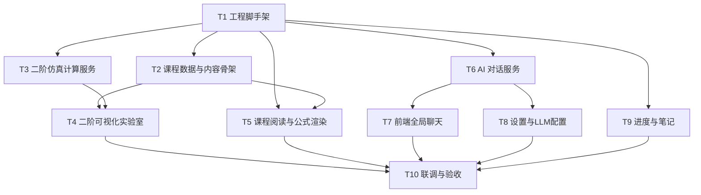

# 开发任务拆分与验收

> 版本：v0.1  
> 读者：智能体团队 / 任务分配者 / 测试智能体  
> 原则：每个任务都可独立验收；所有 Python 操作必须使用 `.venv`。

---

## 1. 任务总览与依赖

| 任务 | 建议负责智能体 | 依赖 |
| --- | --- | --- |
| T1 工程脚手架 | 全栈 | 无 |
| T2 课程数据与内容骨架 | 内容 | T1 |
| T3 二阶仿真计算服务 | 算法/后端 | T1 |
| T4 二阶可视化实验室 | 前端 | T2、T3 |
| T5 课程阅读与公式渲染 | 前端 | T1、T2 |
| T6 AI 对话服务（后端） | 后端 | T1 |
| T7 前端全局聊天 | 前端 | T6 |
| T8 设置与 LLM 配置 | 后端 + 前端 | T6、T1 |
| T9 进度与笔记 | 全栈 | T1 |
| T10 联调、测试与验收 | 测试 | T4、T5、T7、T8、T9 |

> 任务编号已按上述依赖重排，开发时按编号顺序即可；T4/T5/T6/T8/T9 可并行。

---

## 2. 任务详细说明

### T1 工程脚手架

**目标**：建立前后端可运行骨架。

**交付物**
- 根目录 `requirements.txt` 追加：`fastapi`、`uvicorn[standard]`、`httpx`、`PyYAML`、`python-dotenv`、`pytest`。
- `backend/app/main.py`，可启动并返回 `GET /api/v1/health`。
- `frontend/`：Vite + React + TypeScript 项目，`npm run dev` 可打开首页占位。
- Vite `/api` 代理到 `http://127.0.0.1:8000`。
- CORS 仅允许 `http://127.0.0.1:5173` 和 `http://localhost:5173`。
- `data/` 目录与 SQLite 建表脚本（见 02 文档第 6 节）。
- `.gitignore` 忽略 `data/*.db`、`frontend/node_modules`、`frontend/dist`、`.env`、`.npm-cache/`。
- 初始化 Git 仓库并完成基线提交；确认每次改动都会提交。

**验收**
- 按 02 文档第 9 节命令可同时启动前后端。
- `GET /api/v1/health` 返回 `{"status":"ok","version":"0.1.0","llm_mode":"mock"}`。
- 浏览器访问 `http://localhost:5173` 看到占位首页。
- 不破坏已有 `.venv` 和 `Reference/`。
- `git status` 干净，基线提交存在。

---

### T2 课程数据与内容骨架

**目标**：按 Reference 目录生成全量课程树；完成第 5 章五个知识点的可渲染内容。

**交付物**
- `backend/app/content/curriculum.json`：包含卷 1、卷 2 全部章节目录；只有 `ch05` 及其 topics 为 `available`。
- `backend/app/content/ch05/05-01.md` 至 `05-05.md`，符合 02 文档 Frontmatter 规范与 03 文档内容大纲。
- `content_loader.py`：解析目录与 Markdown，返回 topic JSON。
- `GET /api/v1/curriculum`、`GET /api/v1/topics/{topic_id}`。

**验收**
- 目录树标题与 `Reference/*.md` 一致。
- `GET /api/v1/topics/ch05-03` 返回正文、widgets、prev/next。
- 5 个 Markdown 文件均包含学习目标、正文、至少一个 widget 占位。
- 数学公式使用 `$...$` 与 `$$...$$`，推导在 `:::details` 中。

---

### T3 二阶仿真计算服务

**目标**：实现二阶系统计算核心。

**交付物**
- `backend/app/services/second_order.py`。
- `backend/app/routers/compute.py` 与 Pydantic schemas。
- `backend/tests/test_second_order.py`，覆盖 03 文档 6.1 节全部用例。

**接口**
- `POST /api/v1/compute/second-order/simulate`
- `POST /api/v1/compute/second-order/compare`
- `GET /api/v1/compute/second-order/presets`

**验收**
- 所有 pytest 通过。
- 响应结构完全符合 02 文档 5.2 节示例。
- 非法参数返回统一错误格式和指定错误码。

---

### T4 二阶可视化实验室

**目标**：实现核心交互组件。

**交付物**
- `WidgetRenderer.tsx` 注册机制。
- `SecondOrderLab.tsx`、`TimeResponsePlot.tsx`、`PoleZeroMap.tsx`、`MetricsTable.tsx`。
- 滑杆、预设、模式切换、对比、CSV 导出、loading 与错误态。
- 在 `05-02` 至 `05-05` 内容页中正确挂载。

**验收**
- 通过 03 文档 6.2 节 TC-U01 至 TC-U06。
- 所有计算请求均调用后端，前端无仿真求解器实现。
- 白色简洁风格；图表无 Plotly logo；可缩放悬停。

---

### T5 课程阅读与公式渲染

**目标**：章节学习页与 Markdown/KaTeX 渲染。

**交付物**
- `HomePage`、`ChapterPage`。
- 左侧目录树（可折叠、高亮当前项、显示 planned/完成状态）。
- `MarkdownRenderer`：react-markdown + remark-gfm + remark-math + rehype-katex。
- 自定义渲染 `:::details` 为折叠推导块，`[[widget:...]]` 交给 `WidgetRenderer`。
- 上一篇 / 下一篇导航、章节进度显示占位。

**验收**
- 首页展示两卷目录；未开发章节为“规划中”不可进入。
- 第 5 章内容可完整阅读，公式排版正确。
- 推导块默认折叠，点击展开。
- 桌面端 1280px 下布局正常，正文最大宽度合适。

---

### T6 AI 对话服务（后端）

**目标**：实现不写死供应商的 LLM 调用层和 SSE 接口。

**交付物**
- `backend/app/services/llm.py`：OpenAI 兼容流式客户端、Base URL 规范化、超时与错误处理、Mock 模式。
- `backend/app/services/prompt.py`：加载 `tutor_system.md` 并注入当前章节上下文。
- `backend/app/routers/chat.py`：会话与流式接口。
- 数据库表 `chat_sessions`、`chat_messages` 读写。

**验收**
- 不配置 Key 时 `/stream` 返回 Mock 文本，状态为成功。
- 配置 DeepSeek 后，流式事件符合 `meta → delta* → done` 格式。
- 错误事件包含 `code` 和 `message`，不泄露 Key。
- 消息与会话持久化，重启后仍可读取。

---

### T7 前端全局聊天

**目标**：任意页面可用的 AI 对话面板。

**交付物**
- `ChatDock` 悬浮按钮，所有路由可见。
- `ChatPanel` 右滑面板、消息列表、流式打字效果、停止生成按钮。
- 新会话、历史会话切换与删除。
- 当前路由/知识点上下文随请求发送。

**验收**
- 在首页、章节页、设置页均能打开聊天。
- 流式输出逐段显示，刷新后历史仍在。
- Mock 模式下可完成一轮问答。
- 切换页面后，下一条消息携带新页面上下文。

---

### T8 设置与 LLM 配置

**目标**：供应商可切换、默认 DeepSeek。

**交付物**
- 后端 `/settings/llm` GET/PUT/test/reset。
- 设置页：provider 下拉、Base URL、模型名、API Key、温度、最大输出长度。
- Key 脱敏显示、恢复默认配置按钮。
- 前端不存储 Key，只缓存脱敏配置。

**验收**
- 首次启动显示默认 DeepSeek 配置。
- 切换为 Ollama 或其他 OpenAI 兼容地址后，test 接口按新配置请求。
- 保存空 Key 不清空已有 Key。
- 代码全文搜索不存在硬编码 `sk-` 密钥或写死仅 DeepSeek 的分支。

---

### T9 进度与笔记

**目标**：学习数据持久化。

**交付物**
- 进度接口与章节百分比。
- 知识点页面的状态切换控件。
- 笔记新增、编辑、删除；笔记与 topic 关联。
- 首页/目录树展示完成状态。

**验收**
- 标记 ch05-01 完成，目录树出现完成标记。
- 重启后端和刷新浏览器后状态保留。
- 笔记可保存并再次编辑。

---

### T10 联调、测试与验收

> 当前状态（2026-10-02）：自动化验收通过——后端 `97 passed`、前端 `npm run build` 通过、生产单端口 `smoke_api.py` 69/69 通过；P1–P4 问题已修复并回归。  
> 剩余事项：环境缺少可用无头浏览器，TC-U01–U06 的浏览器交互与视觉（白底、KaTeX、拖动、CSV、流式停止）需在 Chrome/Edge 手工复核。详见 `docs/05_MVP验收报告.md`。

**目标**：按 PRD 第 7 节完成 MVP 验收。

**交付物**
- 后端 pytest 全绿。
- API 手工测试记录（可用 Markdown 表格）。
- 前端构建无 TypeScript 错误。
- 生产模式：FastAPI 托管 `frontend/dist`，单端口可访问。
- `docs/` 更新实际启动说明（如有偏差）。

**验收**
- 满足 PRD 第 7 节全部 10 条。
- 满足 03 文档 6.1、6.2 用例。
- 页面白色简洁，无移动端适配要求。
- 计算只在后端，前端无 scipy/numpy 依赖。

---

## 3. Definition of Done（通用）

每个任务完成必须同时满足：

1. 代码按 02 文档目录结构放置，命名清晰，有必要的 docstring/注释。
2. Python 依赖已写入根 `requirements.txt`；前端依赖写入 `frontend/package.json`。
3. 使用 `.venv/bin/python` 运行过相关测试或启动检查。
4. 无硬编码 API Key；无调试用 `print` 污染。
5. 涉及接口的，错误响应符合统一格式。
6. 涉及界面的，符合白色简洁风格与桌面端布局。
7. 在任务完成说明中写明：改动文件、运行命令、验证结果。
8. 每个任务结束时必须产生至少一个 Git commit，且工作区中与任务相关的改动均已提交。

---

## 4. 关键风险与应对

| 风险 | 影响 | 应对 |
| --- | --- | --- |
| LLM 供应商接口差异 | 对话失败 | 统一 OpenAI 兼容协议；设置页可自定义 Base URL；错误分类显示 |
| 用户 Key 泄露 | 安全 | Key 只存服务端 SQLite；响应脱敏；日志脱敏 |
| 公式与指标口径不一致 | 学习误导 | 后端为唯一计算源；测试用例锁定数值 |
| 内容只有目录，AI 可能“编造”教材原文 | 准确性问题 | 系统提示词明确“不声称引用原文”；后续接入正文再增强 |
| 滑杆高频请求 | 卡顿 | 150ms debounce + 取消/忽略过期响应 + 简单缓存 |
| 不稳定系统导致数值发散 | 图表异常 | 参数边界限制、诊断信息、Y 轴自动裁剪提示 |
| 前端直接实现数学逻辑 | 与后端不一致 | 验收明确检查：前端无求解器代码 |

---

## 5. 任务执行建议

1. 先由全栈智能体完成 T1，再由内容/算法/前端/后端智能体并行推进。
2. 内容智能体必须严格按 03 文档写 Markdown，不要自行改公式口径。
3. 算法智能体先写测试用例，再实现 `second_order.py`（TDD）。
4. 前端智能体在 T4 中以 `/api/v1/compute/second-order/*` 的响应结构为契约，可先用固定 JSON mock 开发。
5. 后端智能体在 T6 中可先用 `httpx.MockTransport` 测试 SSE 解析，不依赖真实 Key。
6. 每个任务完成后在团队任务板更新验收证据，并提交一次 Git；测试智能体在 T10 统一复核。
7. 若一次任务产生多个独立可验证步骤，可按步骤多次提交，不要等到全部结束再一次性提交。
